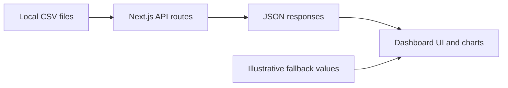

# AgriNova AI Dashboard

## Overview and problem statement

A Next.js dashboard prototype for presenting smart-agriculture operations in a unified interface: farm monitoring, crop health, IoT sensors, robotics and drones, alerts, pricing, sustainability and recommendations. It is designed for demonstration and exploration of agricultural analytics.

> **Data interpretation:** The overview includes hard-coded KPI trends, activity markers, alerts and recommendation text with fallback values. The CSV-backed API routes and charts are demonstration content, not evidence of live farm readings or independently verified AI performance.

## Technology stack

| Component | Resolved npm lock version |
| --- | --- |
| Next.js | 16.2.6 |
| React / React DOM | 19.2.6 |
| TypeScript | 5.7.3 |
| Tailwind CSS | 4.3.0 |
| Recharts | 2.15.0 |
| csv-parse | 6.2.1 |
| Vercel Analytics | 1.6.1 |

Radix UI, Lucide and additional UI packages are declared in [package.json](package.json). Exact npm resolutions are in [package-lock.json](package-lock.json). A pnpm lockfile also exists; do not mix package managers or regenerate locks unnecessarily.

## Architecture and dataset



The `data/` directory contains farms, crops, sensors, weather/soil readings, crop-health scans, robot/drone missions, recommendations, alerts, reports, energy usage, price predictions and blockchain transaction CSVs. Routes read files from the working directory and parse headers using csv-parse. Their presence does not establish real sensor feeds, an operational blockchain or trained AI models. Dataset origin/licensing is not verified.

## Project structure

- [app/page.tsx](app/page.tsx) — dashboard overview.
- [app/](app/) — pages and API routes.
- [components/dashboard/](components/dashboard/) and [components/ui/](components/ui/) — shared presentation components.
- [data/](data/) — CSV fixtures.
- [public/](public/) — static icons and placeholder assets.

## Installation and prerequisites

Node.js >=20.9.0 (Next.js lockfile engine), npm and a modern browser are required. A network connection may be needed during installation and font loading.

```bash
git clone https://github.com/Rmadanmohamed/AgriNova-AI-Dashboard.git
cd AgriNova-AI-Dashboard
npm ci
npm run dev
```

Open the URL printed by Next.js (normally http://localhost:3000). For production:

```bash
npm run build
npm run start
```

## Environment variables

No custom credentials or environment variables were identified in the reviewed CSV API routes and layout. Next.js manages `NODE_ENV`; the production layout enables Vercel Analytics. The sample data must remain available at `data/`.

## Usage and API

Navigate between farm, crop-health, sensor, robotics, sustainability and alert pages. Examples of read-only endpoints:

| Endpoint | Output |
| --- | --- |
| GET /api/summary | Counts and aggregate KPIs, including farms, sensors, health, alerts and energy |
| GET /api/farms | Farm CSV rows as JSON |
| GET /api/sensors | Sensor CSV rows as JSON |
| GET /api/ai-recommendations | Recommendation CSV rows as JSON |

```bash
curl http://localhost:3000/api/summary
```

Additional route directories are under `app/api/`. Reviewed endpoints return HTTP 500 with an error object if reading/parsing fails.

## Testing and validation

No automated test suite was found in the tree. The manifest declares `npm run lint`, `npm run build` and `npm run start`. Run these locally and verify the dashboard and API responses. No build, lint or integration run was executed during this documentation audit; lint configuration may require attention.

## Screenshots and demo

No verified live demo or standalone dashboard screenshot was found. Icons and placeholder assets are not application screenshots.

## Limitations

- Values may be simulated, hard-coded or derived from local example data.
- No authenticated production farm-data connection or operational model inference is established by the reviewed code.
- Functional, accessibility, security and deployment verification remain outstanding.
- No license file was found; do not assume an open-source license.

## Related repository

[AgriNova smart-agriculture dashboard workspace](https://github.com/Rmadanmohamed/agrinova-smart-agriculture-dashboard) includes additional Power BI and documentation assets. Do not assume the two repositories are interchangeable.

**Project status:** Prototype / portfolio demonstration.

## Author

**Ramadan Mohamed Hassan** — AI Engineer | AI Researcher | AI Automation | LLM & RAG Systems | Machine Learning

[Portfolio](https://ramadan-ai-portfolio.vercel.app/) · [LinkedIn](https://www.linkedin.com/in/ramadan-mohamed-89085a366/) · [GitHub](https://github.com/Rmadanmohamed) · [Email](mailto:ramadanmohameddd3@gmail.com)
